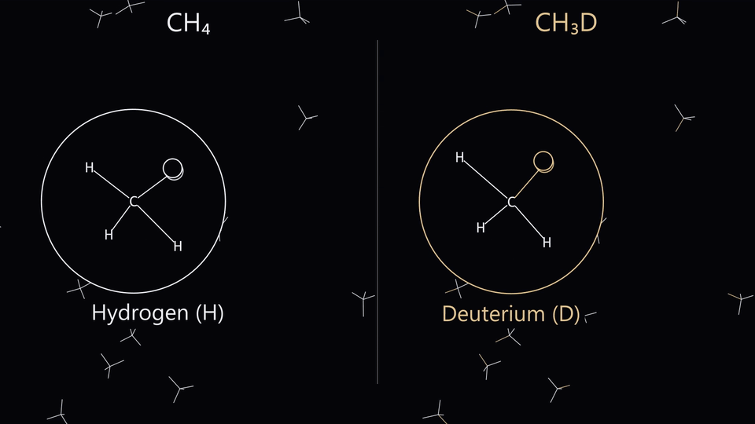
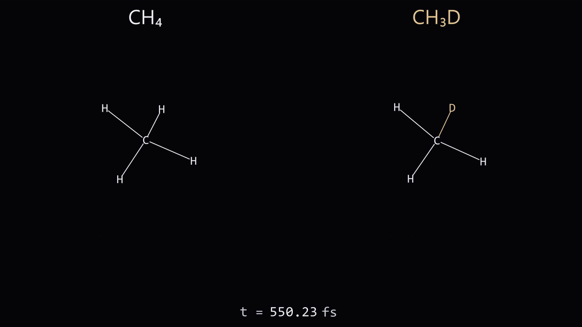
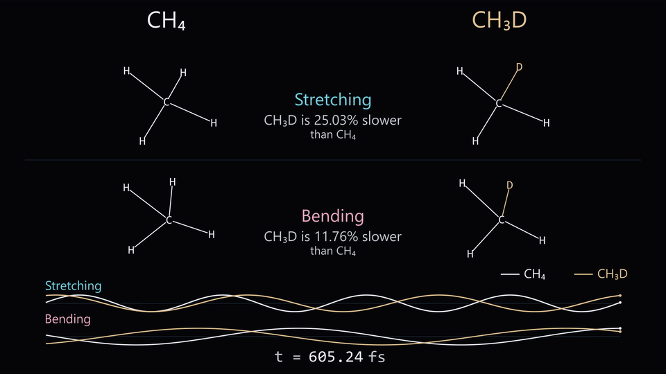
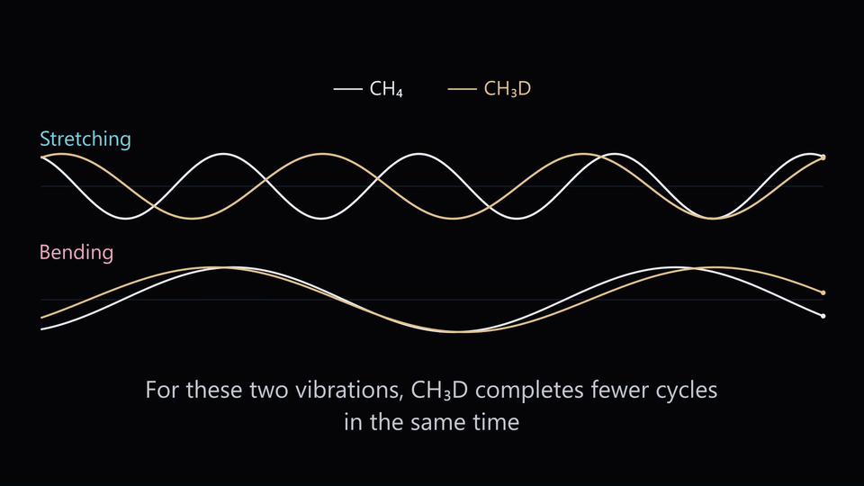

# Computational analysis and visualization of vibrational isotope effects in CH₄ and CH₃D

**One extra neutron changes how a molecule moves.** This project makes that
isotope effect visible by comparing ordinary methane, **CH₄**, with **CH₃D**,
where one hydrogen is replaced by deuterium.

The workflow uses PySCF to optimize the methane geometry and calculate its molecular Hessian.
Harmonic analysis then determines and compares all nine vibrational modes of CH₄ and CH₃D.
Manim visualizes the resulting molecular motion alongside synchronized oscillation plots.

The astronomical motivation is the unusually deuterium-rich methane reported
in interstellar comet **3I/ATLAS** by [Roth and colleagues](https://arxiv.org/abs/2603.20445v3).
The animation is a computational illustration of the molecular isotope effect ([full movie](media/methane-isotope-effect.mp4)).

## Results

### 1. Same element, different nucleus

Deuterium has the same nuclear charge as hydrogen (¹H) but roughly twice its mass.
This greater inertia shifts methane’s vibrational frequencies and changes how its
atoms move together, giving CH₃D a distinct infrared fingerprint.



### 2. Separate two components of the same motion

Stretching vibrations change bond lengths, while bending vibrations change bond angles.
Each mode involves a characteristic pattern of coordinated atomic motion, with some atoms
moving more than others. Replacing H with the heavier D therefore shifts each frequency
by a different amount, depending on how strongly the substituted atom participates in
that vibration.



### 3. Compare equal physical time

Over the same time interval, CH₃D completes fewer oscillations in both selected modes.
The calculated frequency reductions of about 25% for stretching and 12% for bending
correspond to oscillation periods approximately 33% and 13% longer than in CH₄.
The additional nuclear mass therefore changes the timescale of each vibration by a
different amount.



| Selected comparison | CH₄ / cm⁻¹ | CH₃D / cm⁻¹ | Frequency reduction |
|---|---:|---:|---:|
| Symmetric-stretch branch | 3032.1384163 | 2273.2854142 | **25.03%** |
| Lower E-bend component | 1340.9286711 | 1183.2824173 | **11.76%** |

For each pair of corresponding vibrational modes, the relative frequency reduction is

```math
\delta_{\nu} = \frac{\nu_{\mathrm{CH_4}} - \nu_{\mathrm{CH_3D}}}{\nu_{\mathrm{CH_4}}} \times 100\%
```

where $\nu_{\mathrm{CH_4}}$ and $\nu_{\mathrm{CH_3D}}$ are the calculated harmonic
frequencies of the two isotopologues.

### 4. Keep the waves moving to the last frame

In the harmonic approximation, each normal mode oscillates sinusoidally at a fixed
frequency. The frequency differences between CH₄ and CH₃D cause their relative phase
to evolve over time. The constant amplitudes reflect an idealized model without damping.
In real systems, collisions and coupling between modes allow vibrational energy to be
exchanged and redistributed.



The initial GIF uses 30 fps to sample the fast displayed vibrations; the three
already slowed chapters use 12 fps. The complete MP4 retains all 60 fps.

## Two reproducibility paths

| Path | Input | What it reproduces |
|---|---|---|
| **Reference rendering** | Checked-in `data/methane_modes.json` | The accepted numerical mode basis, scene and timing |
| **From scratch** | A tetrahedron constructed by Python | A new optimized geometry, Hessians, extracted modes and rendered film |

The from-scratch path does not read the frozen mode dataset or reference
Hessian to perform its quantum calculation. It generates its own data and
passes them directly to the renderer. The reference path avoids repeating
an expensive calculation when working only on graphics.

Fresh calculations can differ in the last numerical digits and in the chosen
basis within degenerate mode spaces. The frozen data preserve the exact
graphical basis of the approved film; a fresh run reproduces the scientific
comparison without promising byte-identical media. Fonts and encoder versions
can also change pixels across platforms.

## Install

Use **Python 3.12** and install the native dependencies described in the
[Manim installation guide](https://docs.manim.community/en/stable/installation.html).
An **FFmpeg** executable must be available on `PATH`, or supplied with
`--ffmpeg /path/to/ffmpeg`. LaTeX is not used.

For Linux/macOS, after installing those prerequisites:

```bash
python3 -m venv .venv
source .venv/bin/activate
python -m pip install -r requirements.txt
```

For a new quantum calculation, also install the optional quantum requirements:

```bash
python -m pip install -r requirements-qm.txt
```

The requirements pin the versions used for validation. The numerical pipeline
uses PySCF 2.14.0, NumPy 2.5.4 and SciPy 1.18.1; the renderer uses Manim 0.22.1.
No private application or account is required to run the repository.

The preferred reference fonts are Segoe UI and Consolas. On systems without
them, the renderer selects **DejaVu Sans** and **DejaVu Sans Mono**; install
these open fonts if your environment does not already provide them. Font
substitution affects typography, not the computed frequencies or phase.

## Run the entire pipeline from zero

From the repository root, in an environment containing both requirement sets:

```bash
python tools/render.py --from-scratch --previews
```

The command performs every dependent stage in order:

1. Constructs C,H,H,H,H as an ideal tetrahedron.
2. Optimizes its common C–H bond length with converged B3LYP/def2-TZVP calculations.
3. Checks all Cartesian forces and internal/external electronic stability.
4. Computes the full Cartesian Hessian from analytic gradients at ±0.002 bohr,
   then repeats it at half that displacement.
5. Changes the mass of atom 1 from H to D on the same electronic potential.
6. Projects out translations/rotations and extracts all nine physical modes.
7. Tracks matching A1/E subspaces and selects the two displayed comparisons.
8. Renders the full film, normalizes timestamps without reencoding its images,
   decodes and verifies the movie, then generates the four GIF chapters.

Outputs are kept under `build/run/`:

```text
calculation.json          Raw electronic structure and Hessians
calculation.log           Latest PySCF electronic evaluation
calculation.progress.json Latest completed calculation stage
methane_modes.json        Extracted modes and selected comparisons
render_metadata.json      Model, phase and geometry at every video frame
methane-isotope-effect.mp4
verification.json         Encoded-film verification
previews/                 Four chapter GIFs
```

Console output retains the completed-work progress history. Existing completed
calculation/video files are protected; choose a new directory for a fresh run:

```bash
python tools/render.py --from-scratch --work-dir build/another-run --previews
```

The default quantum resource settings are **four CPU threads and 2048 MB** of
PySCF memory allowance, adjustable with `--threads` and `--memory-mb`. A full
calculation and render take minutes, rather than being an instant visualization.

### Windows with a separate WSL quantum environment

The renderer may stay native on Windows while PySCF runs under Ubuntu/WSL.
Create the rendering environment from PowerShell:

```powershell
py -3.12 -m venv .venv
.\.venv\Scripts\python.exe -m pip install -r requirements.txt
```

In an Ubuntu/WSL shell opened in the **same repository directory**, prepare the
quantum interpreter:

```bash
python3 -m venv .venv-qm
.venv-qm/bin/python -m pip install -r requirements-qm.txt
```

Back in PowerShell, one command orchestrates both environments:

```powershell
.\.venv\Scripts\python.exe tools/render.py --from-scratch --qm-wsl --qm-python .venv-qm/bin/python --previews
```

The runner sets WSL's working directory explicitly and translates local Windows
drive paths. It passes argument arrays directly, so spaces in repository paths
do not become shell-quoting problems. `--wsl-distribution` selects a distribution
other than the default `Ubuntu`.

## Run individual stages

Rebuild the accepted reference scene without a quantum recalculation:

```bash
python tools/render.py --work-dir build/reference
```

Calculate and extract independently:

```bash
python -m methane.chemistry --output build/new-calculation.json
python -m methane.modes --input build/new-calculation.json --output build/new-modes.json
python tools/render.py --data build/new-modes.json --work-dir build/new-render
```

Repeat only the numerical extraction from the small reference Hessian:

```bash
python -m methane.modes --input data/reference_calculation.json --output build/reextracted.json
```

Make a quick still preview of the accepted split scene:

```bash
python -m manim --config_file manim.cfg --save_last_frame --fps 60 --media_dir build/still methane/scene.py ComparisonStill
```

Generate new GIFs from the included approved film without changing that film:

```bash
python tools/previews.py --output-dir build/readme-previews
```

All rendering commands use **60 fps**. The scene rejects a different frame
rate because its endpoint is deliberately rounded on the 60 fps grid.

## Numerical method and visual conventions

**Electronic structure.** The model uses isolated, closed-shell methane in the
gas phase: B3LYP/def2-TZVP, grid level 6, grid-response gradients, no density
fitting or added dispersion. SCF energy/orbital-gradient tolerances are
10⁻¹²/10⁻¹⁰, and every Cartesian force must be below 10⁻⁶ Hartree/bohr at the
optimized geometry. A radial optimum alone is insufficient: stability and all
nine physical curvatures are also checked.

**Isotopes.** Both species have the same nuclear charges, electronic Hessian
and equilibrium geometry in this Born–Oppenheimer harmonic model. Only one
nuclear mass changes. Six rigid-motion coordinates are removed in mass-weighted
space before diagonalization, leaving `3N − 6 = 9` vibrations.

**Degenerate modes.** Nearly equal frequencies are clustered within 0.01 cm⁻¹.
The common C3v subgroup separates A1 and E components. Hungarian matching and
SVD parallel transport follow corresponding subspaces through 401 mass steps.
A selected E component uses its cluster mean frequency. Full schema, units and
normalization conventions are documented in [data/README.md](data/README.md).

**Display amplitudes.** Mode vectors are rescaled by their largest atomic-vector
norm. The field superposes all nine with illustrative 0.055 Å coefficients;
the selected pair uses 0.15 Å coefficients before splitting and 0.30 Å per
isolated branch afterward. These enlarged amplitudes and phases are not a
temperature, thermal population or quantum nuclear trajectory.

**Field motion.** Opening translations, rotations and periodic wrapping are
graphical context. They are not solvent molecular dynamics, diffusion or
collisions. The selected object is tracked through the optical zoom and locks
its rigid-body motion before the component guides appear.

**Three clocks.** Actual video seconds map smoothly to model time. Model time
integrates a shared phase coordinate `q`; physical femtoseconds follow
`Δt = q_difference / (2 c ν_reference)`. Each normal coordinate is
`sin(π × frequency_ratio × q)`. Thus the molecular displacement, waveform and
timer cannot drift independently. The final plots show the same eight-q-unit
physical-time window for both isotopes.

The extra comparison time uses a quintic map with unit speed and zero mapping
acceleration at its joins. It extends the completed split comparison from about
8.17 to 10.17 seconds while preserving the **650 fs** plot-zoom trigger and the
continuous final phase.

## Validation

Run the fast suite without launching another DFT calculation:

```bash
python -m unittest discover -s tests -v
```

The tests check the constructed tetrahedron, all nine isotope frequencies from
the reference Hessian, mass-weighted orthogonality and centre-of-mass invariance,
the exact mass substitution, caption ratios, physical-period repetition of
atomic motion, clock derivatives, smooth extra-time joins and live lens
attachment. They also reject malformed datasets and enforce docstrings for
every shipped module, class and named function. README links, GIF motion,
sampling of the fast opening, and retained mode colours are checked as well.

`tools/render.py` automatically runs the encoded-film verifier. It independently
recomputes the clock rather than importing the model's clock function, decodes
every video frame, checks 60 fps timestamps and the timer transition, and tests
each enlarged waveform against the predicted phase. Every final adjacent wave
crop must keep changing, including the last frame pair.

The from-scratch quantum stage also reports the two-step Hessian sensitivity.
The independently validated calculation reproduced shifts of **25.02698%** and
**11.75651%**, agreeing with the reference values at the displayed precision;
its maximum h-to-h/2 frequency change was about **0.003 cm⁻¹**.

## Scope of the astronomical connection

3I/ATLAS was discovered by ATLAS in Chile in July 2025; its trajectory established
an interstellar origin. JWST observations subsequently supplied the methane
isotope result discussed by Roth and colleagues.

This repository calculates isolated-molecule harmonic motion. It does not fit
the comet's spectrum, calculate band intensities, assign the displayed modes
to the observed JWST lines, or infer the comet's birthplace from an animation.
Origin hypotheses rely on measured isotope abundances and astrochemical models.
The contribution here is a transparent, reproducible scientific visualization.

## File map

| File | Responsibility |
|---|---|
| `methane/chemistry.py` | Geometry creation, quantum optimization, stability and two Hessians |
| `methane/modes.py` | Mass weighting, rigid-motion projection, isotope/subspace tracking and JSON extraction |
| `methane/model.py` | Validated data loading, harmonic coordinates, projection, tracked geometry and clocks |
| `methane/scene.py` | Documented Manim classes, graphical updaters and per-frame metadata |
| `tools/render.py` | Complete E2E orchestration, optional Windows/WSL bridge and lossless stream-copy export |
| `tools/previews.py` | Four GIF chapters decoded from the film |
| `tools/verify_render.py` | Independent clock and encoded-wave verification |
| `tests/test_pipeline.py` | Fast numerical, geometric and documentation invariants |
| `data/` | Small reference electronic result, accepted mode dataset and schema documentation |
| `media/` | Approved full-resolution MP4 and four inline GIF excerpts |
| `requirements*.txt`, `manim.cfg` | Reproducible dependency sets and Cairo/encoder settings |

Generated work stays in ignored `build/` directories. There are no paper PDFs,
private reports, intermediate renders, vendored executables or application code.

## References

- [Roth et al., *An Enriched Methane D/H Ratio in the Interstellar Object 3I/ATLAS* — free author version](https://arxiv.org/abs/2603.20445v3)
- [Associated Nature Astronomy article](https://doi.org/10.1038/s41550-026-03002-5)
- [NASA: 3I/ATLAS facts and FAQs](https://science.nasa.gov/solar-system/comets/3i-atlas/3i-atlas-facts-and-faqs/)
- [PySCF: density-functional theory](https://pyscf.org/user/dft.html)
- [Manim Community documentation](https://docs.manim.community/en/stable/)

## License

The code and included project-generated data/media are released under the
[MIT License](LICENSE). Referenced papers and third-party dependencies retain
their own licenses.
